<p><picture><source media="(max-width: 600px)" srcset="assets/readme/hero-mobile.svg"/>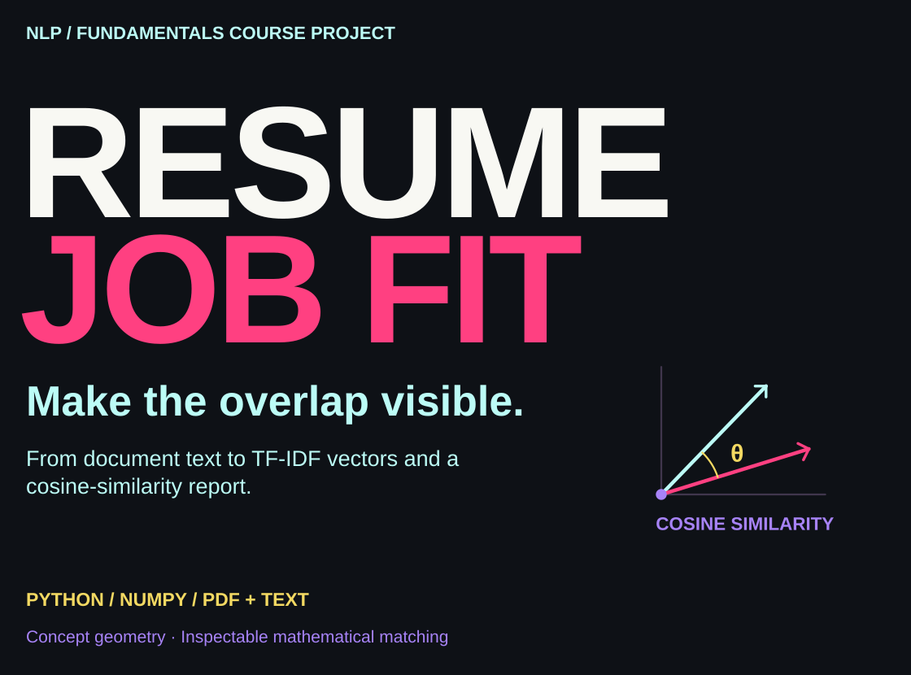</picture></p>

<p align="center"><a href="#what-it-does">Overview</a> · <a href="#from-text-to-vectors">Pipeline</a> · <a href="#run-locally">Run locally</a> · <a href="#test-the-mathematics">Tests</a> · <a href="#scope-and-data-handling">Scope</a> · <a href="#explore-the-code">Explore</a></p>

This is my course project for Fundamentals in Artificial Intelligence and Machine Learning: a local command-line tool that compares a resume with a job description using a custom NLP pipeline. It makes the mathematical comparison inspectable, from text extraction to the final report.

<a id="what-it-does"></a>

##  What it does

<p><picture><source media="(max-width: 600px)" srcset="assets/readme/features-mobile.svg"/>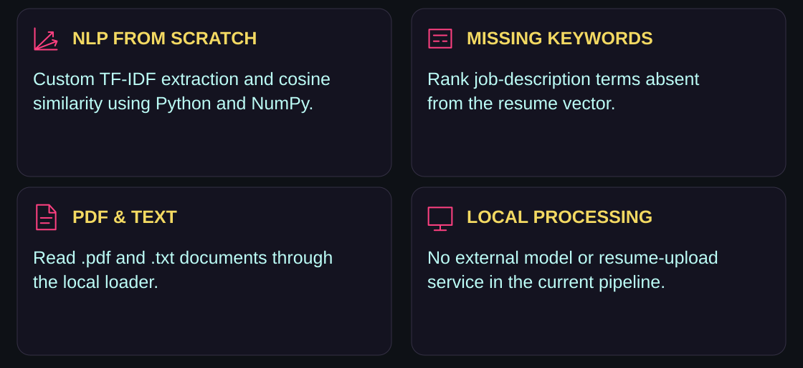</picture></p>

The application extracts both documents, builds a shared vocabulary, computes TF-IDF vectors and prints a similarity percentage. It also lists up to ten job-description terms that pass the project’s importance cutoff and are absent from the resume vector.

<a id="from-text-to-vectors"></a>

##  From text to vectors

<p><picture><source media="(max-width: 600px)" srcset="assets/readme/pipeline-mobile.svg"/>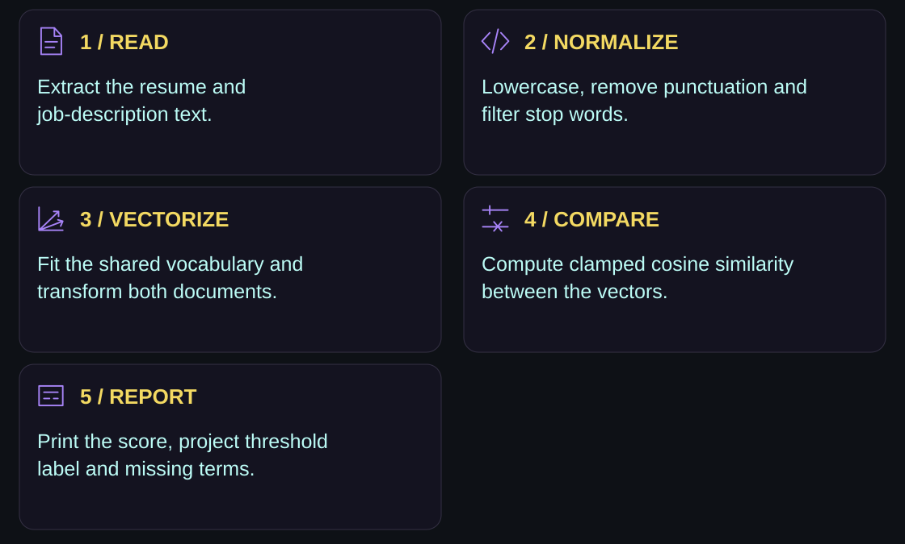</picture></p>

<p><picture><source media="(max-width: 600px)" srcset="assets/readme/similarity-mobile.svg"/>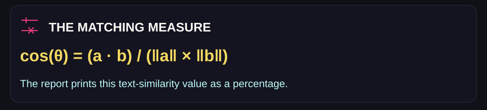</picture></p>

<details>
<summary><strong>Implementation details</strong></summary>

- The extractor fits its vocabulary on the supplied job description and resume.
- Text normalization keeps alphabetic tokens and removes configured stop words.
- The vocabulary is capped at `MAX_FEATURES = 1000`.
- The implemented IDF expression is `log(N / (df + 1)) + 1`; term frequency is divided by the document’s token count.
- Cosine similarity is clamped to `[0, 1]`, with zero-vector handling.
- The report’s strong/weak label uses the project constant `SIMILARITY_THRESHOLD = 0.65`.
- Missing terms require a job-vector weight above `0.05` and a zero resume-vector weight, then are ranked and limited to ten.

These are implementation choices in this course project, not thresholds supplied by an employer or ATS vendor.

</details>

<a id="run-locally"></a>

##  Run locally

<p><picture><source media="(max-width: 600px)" srcset="assets/readme/environment-mobile.svg"/>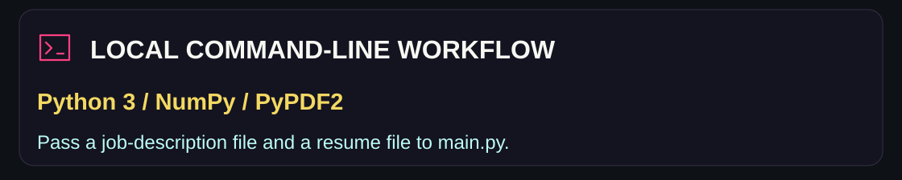</picture></p>

Clone the repository:

```bash
git clone https://github.com/adilsukumar/ATS-Resume-Job-Fit-Analyzer.git
cd ATS-Resume-Job-Fit-Analyzer
```

Create and activate an environment:

```bash
python -m venv venv
# On Windows:
venv\Scripts\activate
# On Mac/Linux:
source venv/bin/activate
```

Install dependencies and run the included text samples:

```bash
pip install -r requirements.txt
python main.py --jd sample_jd.txt --resume sample_resume.txt
```

Use `.txt` or text-extractable `.pdf` files with the same `--jd` and `--resume` arguments. The loader uses PyPDF2 for PDF text extraction; it does not include an OCR stage for scanned documents.

<a id="test-the-mathematics"></a>

##  Test the mathematics

```bash
python -m unittest test_model.py
```

The existing tests cover a known cosine-similarity example, zero-vector handling and the TF-IDF extractor’s vector shape/non-zero output. The repository also contains [recorded test output](test_execution_proof.txt).

<a id="scope-and-data-handling"></a>

##  Scope and data handling

<p><picture><source media="(max-width: 600px)" srcset="assets/readme/scope-mobile.svg"/>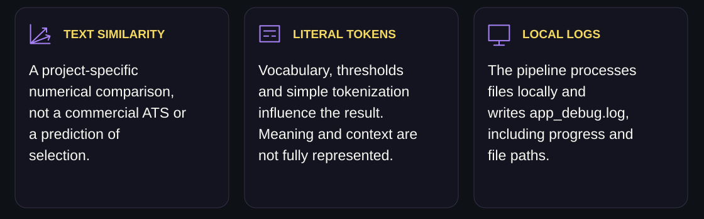</picture></p>

The score describes overlap under this implementation. It does not predict hiring outcomes or reproduce a commercial ATS. Alphabetic tokenization can discard numbers and punctuation-heavy skill names, and literal keyword overlap can miss meaning, synonyms and experience context.

The current pipeline does not call an external model or upload service. It writes local diagnostic information to `app_debug.log`, including file paths, progress and errors. Keep private input documents and generated logs out of public commits.

<a id="explore-the-code"></a>

##  Explore the code

<p align="center"><a href="features.py">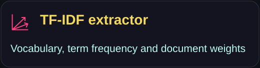</a> <a href="model.py">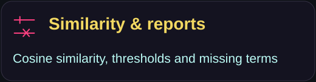</a> <a href="test_model.py">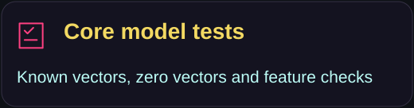</a> <a href="Design_Artifacts.md">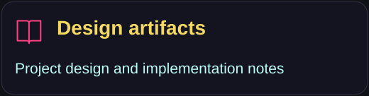</a></p>

See the [project report](ProjectReport.pdf) and [project statement](statement.md) for the accompanying course material.

<p><picture><source media="(max-width: 600px)" srcset="assets/readme/closing-mobile.svg"/>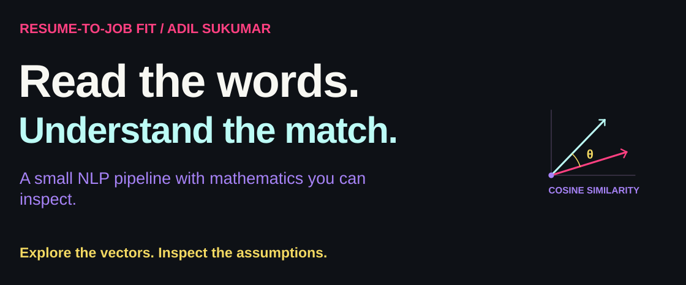</picture></p>

<p align="center"><a href="https://github.com/adilsukumar/ATS-Resume-Job-Fit-Analyzer/issues">Discuss an improvement</a> · <a href="features.py">Inspect the mathematics</a> · <a href="https://www.adilsukumar.xyz/">Meet the builder</a></p>
